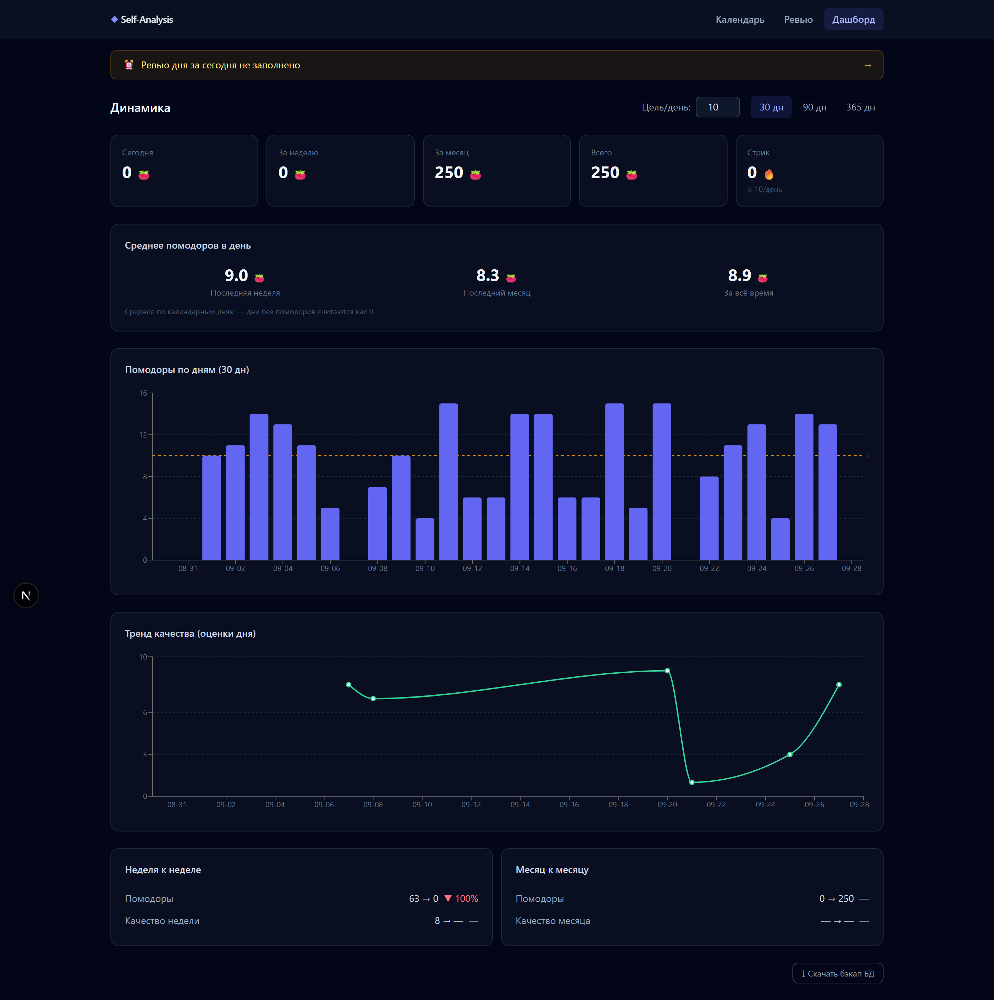
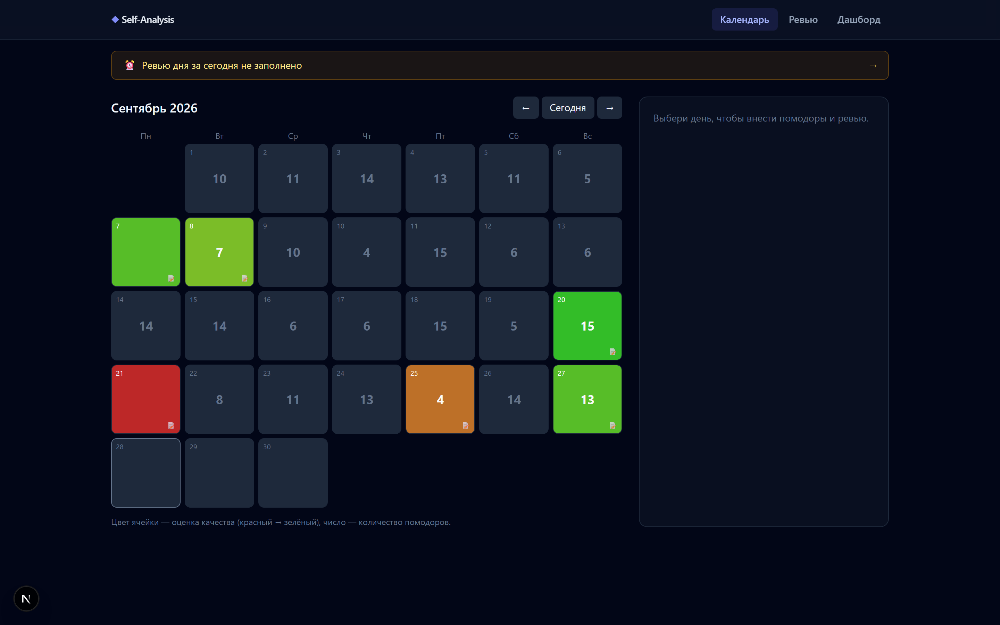
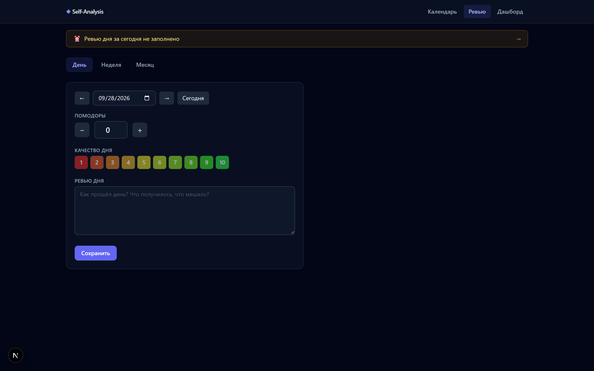

# Self-Analysis Dashboard

Личный трекер продуктивности: вручную вносишь количество помодоров за каждый
день, пишешь ревью дня / недели / месяца и смотришь динамику (количество и
качество) на дашборде.

## Возможности

- **Календарь** — сетка месяца, число помодоров в ячейке + цветовая заливка по
  оценке качества (красный → зелёный). Клик по дню → ввод помодоров, оценки и
  ревью дня.
- **Ревью** — вкладки День / Неделя / Месяц. Недельное (по воскресеньям) и
  месячное (1-го числа) ревью включают итоги и планы на следующий период. Слева
  форма, справа список прошлых ревью для перечитывания.
- **Дашборд** — столбики помодоров по дням с линией дневной цели, тренд
  качества, стрик, суммы за сегодня/неделю/месяц/всё время и дельты
  неделя-к-неделе / месяц-к-месяцу.
- **Напоминания** — баннер подсказывает, что пора заполнить ревью дня, а по
  воскресеньям/1-го числа — недельное/месячное ревью.

## Стек

Next.js (App Router, TypeScript) · SQLite через `better-sqlite3` · Recharts ·
Vitest.

## Скриншоты

### Дашборд


### Календарь


### Ревью


## Запуск

```bash
npm install
npm run dev
# открой http://localhost:3000
```

## Данные

Всё хранится в одном файле `data.db` (SQLite) в корне проекта. Он создаётся
автоматически при первом запросе.

- **Перенос на другую машину** — просто скопируй `data.db`.
- **Бэкап** — кнопка «Скачать бэкап БД» на дашборде (или скопируй `data.db`).
- `data.db` и любые бэкапы в `.gitignore` — личные данные не попадают в репозиторий.

## Тесты

```bash
npm test        # разово
npm run test:watch
```

Покрыты чистые модули: `lib/dates` (границы недель/месяцев, переходы года) и
`lib/stats` (суммы, стрик, дельты).

## Настройки

Дневная цель по помодорам меняется прямо на дашборде (поле «Цель/день»).
